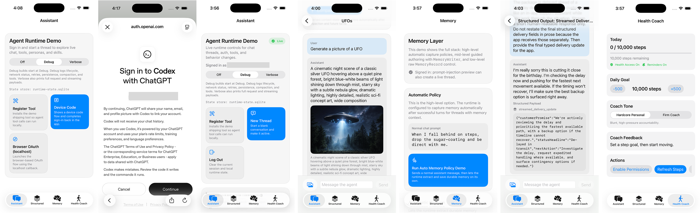

# CodexKit

[](https://github.com/timazed/CodexKit/actions/workflows/ci.yml)
[](https://github.com/timazed/CodexKit/releases/tag/v2.2.0)

**Build AI-powered iOS and macOS apps with ChatGPT sign-in.**

Let users power their in-app AI experience through their own ChatGPT accounts. No API keys to manage and no developer-funded OpenAI API usage for the built-in account-backed integration.

CodexKit is a native Swift AI agent SDK with streaming, app-defined tools, **SQLite or Realm** conversation persistence, optional local memory, and SwiftUI integration.

**iOS 17+ · macOS 14+ · Swift 6.1+ · Xcode 16.3+**

**[Build your first SwiftUI app →](docs/swiftui-assistant.md)**

CodexKit is an independent project, not an official OpenAI SDK. Account eligibility, models, and usage limits depend on provider support and the user's account. See [ChatGPT sign-in and access](docs/chatgpt-account-access.md).

## Contents

- [Installation](#installation)
- [Quickstart](#quickstart)
- [Capabilities](#capabilities)
- [Why an embedded Swift agent runtime?](#why-an-embedded-swift-agent-runtime)
- [Demo apps](#demo-apps)
- [Cloud execution with npm](#cloud-execution-with-npm)
- [Documentation](#documentation)
- [Project](#project)
- [License](#license)

[](DemoApp/README.md)

*Screens from the [full iOS demo](DemoApp/README.md). The getting-started guide builds a smaller chat interface in your own app.*

## Installation

In Xcode, choose **File → Add Package Dependencies**, enter the URL below, and select version **2.2.0**:

```text
https://github.com/timazed/CodexKit
```

Add the products your app needs:

| Product | Purpose |
| --- | --- |
| `CodexKit` | Agent runtime, authentication, tools, and memory APIs |
| `CodexKitUI` | Optional SwiftUI helpers for observable state and prompts |
| `CodexKitSQLite` | Conversation and memory storage using SQLite through GRDB |
| `CodexKitRealm` | Conversation and memory storage using RealmSwift |

Choose one persistence adapter to keep conversations across app launches. Credentials are stored separately in Keychain. See [persistence configuration](docs/persistence.md) for storage locations and migration.

## Quickstart

**[Build a SwiftUI AI app with ChatGPT sign-in](docs/swiftui-assistant.md)** walks through:

1. Creating a view model and signing in with ChatGPT.
2. Sending messages and displaying streaming responses.
3. Restoring saved conversations with SQLite or Realm.
4. Registering an app-defined tool and presenting approvals.

Each stage adds a small piece of code and includes a check to run. Complete [view-model](Examples/ChatViewModel.swift) and [view](Examples/ChatView.swift) files are available at the end.

Already integrating a runtime? Go directly to [app-defined tools](docs/app-defined-tools.md), [model configuration](docs/backend-configuration.md), or [SDK integration](docs/sdk-integration.md).

## Capabilities

| Capability | What you can build |
| --- | --- |
| [ChatGPT sign-in](docs/chatgpt-account-access.md) | Account-backed AI features without API-key entry; device-code and browser flows, plus optional local Codex session reuse on macOS |
| [Streaming and structured output](docs/streaming-output.md) | Live text responses and validated typed results |
| [App-defined tools](docs/app-defined-tools.md) | Agents that read app data or perform authorized actions, with approval controls |
| [SQLite or Realm persistence](docs/persistence.md) | Saved conversations, resumable threads, and context compaction |
| [Optional local memory](docs/memory.md) | Capture selected information and retrieve it for later requests, separately from conversation history |
| [Personas and skills](docs/personas-and-skills.md) | App-specific instructions and tool policies |
| [Images](docs/messaging.md) | Image input, generation, and editing |
| [Runtime controls](docs/upstream-runtime-features.md) | Model discovery, usage-limit reporting, progress, interruption, and bounded parallel tools |

See the [full feature matrix](docs/index.md#feature-matrix) for supported behavior.

## Why an embedded Swift agent runtime?

CodexKit runs agent orchestration inside your app: conversation state, tool execution, approvals, and persistence. Your app owns the interface and implements the tools. The built-in backend sends model requests to the ChatGPT Codex service, so inference requires network access.

The core Swift integration does not require a separate Codex app-server, running desktop app, CLI process, or Node backend.

See [how the embedded runtime works](docs/embedded-agent-runtime.md) for the data flow and integration comparison.

## Demo apps

The repository includes native iOS and macOS demos with sign-in, streaming chat, tools, approvals, structured output, memory, and persistence options.

```sh
open DemoApp/CodexKitDemo.xcodeproj
```

Select **CodexKitIOSDemo** or **CodexKitMacDemo**. Follow the [demo setup and walkthrough](DemoApp/README.md#try-the-runtime-features) for configuration and verification commands.

## Cloud execution with npm

The optional [`@timazed/codexkit`](packages/codexkit/README.md) package lets a Node.js backend execute CodexKit-prepared text, structured JSON, and image generation/edit requests. Swift apps do not need Node or npm.

The bridge executes selected requests; your backend supplies authentication custody, job storage, retries, and result delivery. Text/JSON execution is tool-free.

See the [package guide and limitations](packages/codexkit/README.md) and [remote execution guide](docs/remote-execution.md). Cloud releases use separate `cloud-v*` tags.

## Documentation

Use the [documentation index](docs/index.md) for the complete guide list. Common integration topics:

| Topic | Guides |
| --- | --- |
| Authentication | [iOS sign-in](docs/auth-on-ios.md) · [macOS session reuse](docs/auth-on-macos.md) · [Account access](docs/chatgpt-account-access.md) |
| Messages and results | [Messaging and images](docs/messaging.md) · [Structured output](docs/streaming-output.md) · [Structured recovery](docs/structured-request-recovery.md) |
| App integration | [SDK lifecycle](docs/sdk-integration.md) · [Apple integrations](docs/apple-integrations.md) · [Session transfer](docs/session-transfer.md) |
| Diagnostics | [Logging and troubleshooting](docs/logging-and-troubleshooting.md) · [Usage telemetry](docs/usage-telemetry.md) |

## Project

Latest Swift release: [v2.2.0](https://github.com/timazed/CodexKit/releases/tag/v2.2.0). See the [changelog](CHANGELOG.md) and [migration guide](docs/migration.md) for changes and upgrades.

To build and test a checkout on macOS with Xcode installed:

```sh
swift build --force-resolved-versions
swift test --force-resolved-versions
```

[Contributing](CONTRIBUTING.md) · [Verification](docs/verification.md) · [Security policy](SECURITY.md)

## License

[MIT](LICENSE) — free to use, modify, and redistribute, including in commercial apps, while retaining the copyright and license notice. Provider services and third-party dependencies remain subject to their own terms and licenses.
