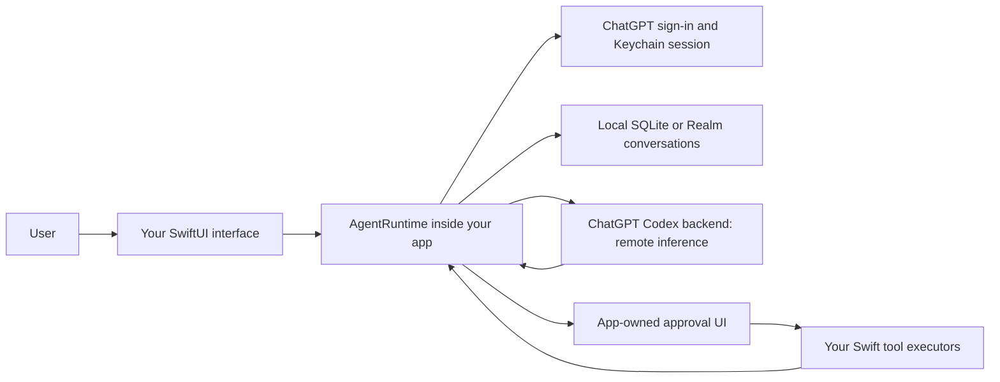

# How CodexKit's embedded Swift agent runtime works

[Documentation index](index.md) · [CodexKit](../README.md)

CodexKit embeds AI agent orchestration in an iOS or macOS app. Users sign in with ChatGPT, the remote model produces responses and tool requests, and the app executes the capabilities it has registered. No separate Codex app-server is required.

## What runs where?

The runtime manages thread state, streams, tool rounds, approvals, and persistence. `CodexResponsesBackend` uses the account-backed endpoint at `https://chatgpt.com/backend-api/codex`. Model inference is remote; embedding the runtime does not make the models available offline.

The app decides which tools exist and implements their effects. A tool can read app state, call an authorized service, or update a local record. Only registering a tool makes it available; the model does not gain general access to device APIs. Tool results included in a turn are sent back to the provider for the next response.

## Choose an integration approach

These are architectural patterns, not claims about every SDK in each category.

| Approach | Where orchestration lives | What your app integrates |
| --- | --- | --- |
| Model API client | Usually in code you build around the client | Request/response transport plus your own conversation and tool workflow |
| Client of a separate agent server | In the server process | Server lifecycle, protocol, and access to its runtime |
| CodexKit's built-in runtime | Inside your Swift app | Native thread, tool, approval, storage, and authentication APIs; remote model inference |

CodexKit does not require the Codex desktop app, a CLI process, or Node for the normal Swift integration. macOS apps may optionally reuse an accessible local Codex session. A separate [Node execution bridge](../packages/codexkit/README.md) supports selected prepared requests; it is not required for chat or local tools.

## Account access and app ownership

ChatGPT sign-in removes API-key entry from the user flow and developer-funded OpenAI API billing from the built-in account-backed path. It does not remove account limits or your own app/backend costs. See [account access and provider dependencies](chatgpt-account-access.md).

Conversation persistence and optional memory belong to your integration. They do not import a user's existing ChatGPT conversations or saved ChatGPT memory. Your app also owns authentication presentation, tool authorization, retention/deletion controls, and UI design.

Start with the [SwiftUI assistant](swiftui-assistant.md), then [add an app-defined tool](app-defined-tools.md). For implementation details, see [runtime architecture](runtime-architecture.md).
