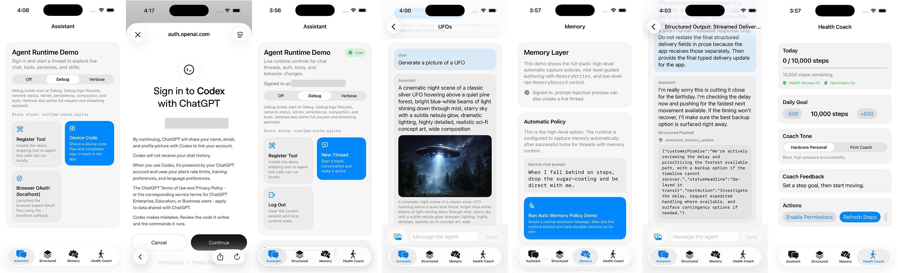

# Build a SwiftUI AI assistant with ChatGPT sign-in

[Documentation index](index.md) · [CodexKit](../README.md)

Build an iOS or macOS app where a user signs in with ChatGPT, sends a message, watches the response stream, and returns to a saved conversation. No API-key entry is needed. Account access and usage limits are described in the [sign-in guide](chatgpt-account-access.md).

You will create two files in your own app: `ChatViewModel.swift` for runtime setup and actions, and `ChatView.swift` for presentation. Build the files gradually using the additions below. Each stage ends with a check you can run. The complete files are linked at the end; the repository demo is not required.

## 1. Create the app and add CodexKit

Create an **App** project in Xcode with **SwiftUI** as the interface and **Swift** as the language. Set the deployment target to iOS 17 or macOS 14. Use Xcode 16.3 or newer and Swift 6.1 or newer.

In **File → Add Package Dependencies**, enter:

```text
https://github.com/timazed/CodexKit
```

Select version **2.2.0**. Add `CodexKit` and `CodexKitUI` to your app target, then choose a storage product in the next step.

## 2. Choose where conversations are saved

The runtime needs a state store to save threads and messages. A persistent store keeps conversations available after the app closes. This is separate from sign-in credentials, which the example stores in Keychain.

CodexKit provides two database adapters:

| Add this package product | Import | Create this state store |
| --- | --- | --- |
| `CodexKitSQLite` | `import CodexKitSQLite` | `try SQLiteRuntimeStateStore()` |
| `CodexKitRealm` | `import CodexKitRealm` | `try RealmRuntimeStateStore()` |

Choose one. This walkthrough uses **SQLite**, so add `CodexKitSQLite` to follow the code unchanged. To use **Realm**, add `CodexKitRealm`, change the adapter import, and use `RealmRuntimeStateStore()` in the runtime setup below. The rest of the view is the same.

Both adapters manage dedicated CodexKit database files. They do not write into your app's existing database. Switching adapters later does not move saved conversations automatically; see [persistence and migration](persistence.md).

## 3. Create the view model and sign-in setup

Create `ChatViewModel.swift` in your app target. Start with the state and sign-in actions:

```swift
import Foundation
import Observation
import CodexKit
import CodexKitSQLite
import CodexKitUI

@MainActor
@Observable
final class ChatViewModel {
    private(set) var store: AgentRuntimeStore?
    private(set) var setupError: String?
    private(set) var isBusy = false
    private var isStarting = false

    // Add start() here in step 3.

    func signIn() { perform { await $0.signIn() } }
    func signOut() { perform { await $0.signOut() } }
    func dismissError() { store?.dismissError() }

    private func perform(_ operation: @escaping @MainActor (AgentRuntimeStore) async -> Void) {
        guard let store, !isBusy else { return }
        isBusy = true
        Task {
            defer { isBusy = false }
            await operation(store)
        }
    }
}
```

`store` exposes the SDK's observable session and conversation state. `perform` keeps sign-in and sign-out from overlapping and resets `isBusy` when an action finishes.

Replace the `// Add start() here in step 3.` comment with this method **inside `ChatViewModel`**:

```swift
func start() async {
    guard store == nil, !isStarting else { return }
    isStarting = true
    setupError = nil
    defer { isStarting = false }
    do {
        let approvals = ApprovalInbox()
        let deviceCode = DeviceCodePromptCoordinator()
        let runtime = try AgentRuntime(configuration: .init(
            authProvider: try ChatGPTAuthProvider(
                method: .deviceCode,
                deviceCodePresenter: deviceCode
            ),
            secureStore: KeychainSessionSecureStore(
                service: "MyChatApp.ChatGPTSession",
                account: "main"
            ),
            backend: CodexResponsesBackend(configuration: .init(
                model: .gpt56Sol,
                reasoningEffort: .low
            )),
            approvalPresenter: approvals,
            stateStore: try SQLiteRuntimeStateStore()
        ))
        // Tool registration goes here in step 7.
        let prepared = AgentRuntimeStore(
            runtime: runtime,
            approvalInbox: approvals,
            deviceCodeCoordinator: deviceCode
        )
        try Task.checkCancellation()
        store = prepared
    } catch is CancellationError {
        // A later appearance can retry startup.
    } catch {
        setupError = error.localizedDescription
    }
}
```

The view model now constructs the runtime. The device-code coordinator supplies the sign-in prompt, Keychain stores credentials, and the state store saves conversations. We will add conversation restoration in step 6.

Change `MyChatApp.ChatGPTSession` to your app's Keychain service identifier. If you chose Realm, change the import and state-store initializer as described in step 2. Choose a [model available to the account](backend-configuration.md).

## 4. Build the sign-in screen

Create `ChatView.swift` and add this initial view:

```swift
import SwiftUI
import CodexKitUI

@MainActor
struct ChatView: View {
    @State private var model = ChatViewModel()

    var body: some View {
        Group {
            if let store = model.store {
                content(store: store)
            } else if let error = model.setupError {
                Text(error)
                Button("Retry") { Task { await model.start() } }
            } else {
                ProgressView("Preparing chat…")
            }
        }
        .task { await model.start() }
    }

    private func content(store: AgentRuntimeStore) -> some View {
        VStack(alignment: .leading, spacing: 12) {
            if store.session == nil {
                Button("Sign in with ChatGPT") {
                    model.signIn()
                }
                .disabled(model.isBusy)
            } else {
                Text("Signed in")
                Button("Sign out") { model.signOut() }
                    .disabled(model.isBusy)
            }

            if let prompt = store.deviceCodeCoordinator?.currentPrompt {
                Text("Enter this code: \(prompt.userCode)")
                    .textSelection(.enabled)
                Link("Continue ChatGPT sign-in", destination: prompt.verificationURL)
            }

            if let error = store.lastError {
                Text(error).foregroundStyle(.red)
                Button("Dismiss error") { model.dismissError() }
            }
        }
        .padding()
    }

}
```

The view's `.task` calls the view model's startup method. Setup and actions stay in the view model; the view displays the resulting state.

In your existing app entry point, replace the starting view with `ChatView()`:

```swift
import SwiftUI

@main
struct MyChatApp: App {
    var body: some Scene {
        WindowGroup {
            ChatView()
        }
    }
}
```

Keep only one `@main` app type. If your macOS app uses App Sandbox, enable **Outgoing Connections (Client)**.

**Run it:** choose **Sign in with ChatGPT**, open the verification link, and enter the displayed code. Complete sign-in and return to your app. You should see **Signed in** and **Sign out**. Errors appear below the sign-in controls.

## 5. Add messaging and streaming

Add these properties **inside `ChatViewModel`, above `start()`**. Keep the existing `isStarting` property:

```swift
private(set) var isSending = false
var draft = ""

var canSend: Bool {
    store?.session != nil && !isBusy &&
    !draft.trimmingCharacters(in: .whitespacesAndNewlines).isEmpty
}
```

Then add these methods **inside `ChatViewModel`, below `signOut()`**:

```swift
func send() {
    guard canSend else { return }
    let text = draft
    draft = ""
    isSending = true
    perform { store in
        defer { self.isSending = false }
        await store.send(text)
    }
}

func stop() {
    guard let store, isSending else { return }
    Task { await store.interrupt() }
}
```

`send()` captures the draft and passes it to the SDK store. The store creates a thread when none is selected. `stop()` requests interruption of the current response.

In `ChatView.content(store:)`, insert the following **after the device-code prompt block and before `if let error = store.lastError`**:

```swift
ScrollView {
    VStack(alignment: .leading, spacing: 12) {
        ForEach(store.messages) { message in
            Text(message.displayText)
        }
        if !store.streamingText.isEmpty {
            Text(store.streamingText)
        }
    }
    .frame(maxWidth: .infinity, alignment: .leading)
}

HStack {
    TextField("Message", text: $model.draft)
    Button("Send") {
        model.send()
    }
    .disabled(!model.canSend)
    if model.isSending {
        Button("Stop") { model.stop() }
    }
}
```

The store publishes partial text through `streamingText`. When the response commits, it clears that partial text and adds the completed message to `messages`.

**Run it:** send “Give me three ideas for a weekend project.” Your message should appear, the reply should grow as text arrives, and the finished response should remain visible. Try **Stop** during a longer response. Sending and conversation changes are disabled while a turn is running.

## 6. Restore and select saved conversations

The database adapter already saves conversation state. Now load it at startup. In `ChatViewModel.start()`, insert this line **after constructing `prepared` and before `try Task.checkCancellation()`**:

```swift
await prepared.restore()
```

Add these methods **inside `ChatViewModel`, below `signOut()`**:

```swift
func newConversation() { perform { await $0.createThread(title: "Conversation") } }
func selectConversation(id: String) {
    perform { await $0.activateThread(id: id) }
}
```

In `ChatView.content(store:)`, replace the signed-in `else` block containing `Text("Signed in")` and its sign-out button with:

```swift
HStack {
    Button("New conversation") {
        model.newConversation()
    }
    Button("Sign out") { model.signOut() }
}
.disabled(model.isBusy)
Menu("Saved conversations") {
    ForEach(store.threads) { thread in
        Button(thread.title ?? "Conversation") {
            model.selectConversation(id: thread.id)
        }
    }
}
.disabled(model.isBusy)
```

Keep the surrounding `else { ... }` braces. `selectConversation(id:)` activates a saved thread and loads its messages; `newConversation()` starts a separate one.

**Run it:** send a message, close the app, and reopen it. Select the thread under **Saved conversations** and check that its messages return. Choose **New conversation** and check that the history is empty.

Signing out ends the session without deleting saved conversations. For larger thread lists, use the paging APIs in the [persistence guide](persistence.md).

## 7. Add an app-defined tool and approval controls

In `ChatViewModel.start()`, replace `// Tool registration goes here in step 7.` with this registration, **after constructing `runtime` and before constructing `prepared`**:

```swift
try await runtime.registerTool(
    ToolDefinition(
        name: "project_status",
        description: "Read the current project's status.",
        inputSchema: .object([
            "type": .string("object"),
            "properties": .object([:]),
            "additionalProperties": .bool(false)
        ]),
        approvalPolicy: .requiresApproval,
        approvalMessage: "Share the current project status with the assistant?"
    ),
    executor: AnyToolExecutor { invocation, _ in
        // Replace this sample result with an authorized read from your app.
        .success(invocation: invocation, text: "Sample project: 3 tasks remaining.")
    }
)
```

This tool returns illustrative project data. Replace the executor's sample result with an authorized read from your app when integrating a real capability.

Add these methods **inside `ChatViewModel`**:

```swift
func approveTool() { store?.approvalInbox?.approveCurrent() }
func denyTool() { store?.approvalInbox?.denyCurrent() }
```

In `ChatView.content(store:)`, insert this block **between the message `ScrollView` and the composer `HStack`**:

```swift
if let approval = store.approvalInbox?.currentRequest {
    Text(approval.title).bold()
    Text(approval.message)
    HStack {
        Button("Approve") { model.approveTool() }
        Button("Deny") { model.denyTool() }
    }
}
```

**Run it:** ask “Use project_status to tell me how the project is going.” When the model requests the tool, the approval prompt should appear. **Approve** lets the tool return its sample status; **Deny** prevents execution. Tool selection is model-driven, so a request does not guarantee a tool call.

Keep approval buttons enabled while a turn waits. See [app-defined tools](app-defined-tools.md) for argument validation, authorization, and execution details.

## Next: optional memory

Conversation history records a thread's messages. Memory retains selected information for retrieval in later requests, under your app's capture and retrieval policies. It uses its own SQLite or Realm store and is separate from restoring conversations. Follow the [memory guide](memory.md) when you need it.

## Complete files

Compare your finished code with these files. They include every stage above, including the sample project-status tool:

- [ChatViewModel.swift](../Examples/ChatViewModel.swift): runtime configuration, sign-in, messaging, conversations, and tool actions.
- [ChatView.swift](../Examples/ChatView.swift): sign-in prompts, streaming messages, conversation controls, and approval UI.

For an extended interface with images, structured output, and model selection, explore the optional [iOS and macOS demos](../DemoApp/README.md).



*The screenshot shows the full demo, not the screen built in this walkthrough.*
